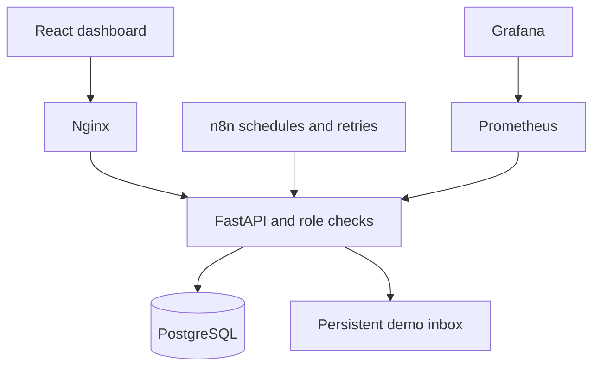

# HealthOps
### Full-stack clinic operations & n8n workflow automation

An industry-style **portfolio demonstration** for managing fictional clinic appointments, vaccine batches, inter-clinic transfers, and operational notifications. Built with React, TypeScript, FastAPI, PostgreSQL, Docker, and n8n.

**Not a clinical system or a production-readiness claim. All patient references are fictional `DEMO-*` IDs. No email, SMS, or external notification delivery exists in this build.**

## Product capabilities

- Responsive operations dashboard connected to the API, with inventory by clinic, appointment search, and role-aware actions.
- Admin, manager, and nurse accounts; scrypt password hashes and short-lived signed bearer tokens held only in browser memory.
- Batch inventory with expiration dates, receipt and wastage audit records, and first-expiring eligible batch selection.
- Conditional stock updates prevent two bookings from consuming the last available dose. Booking failures roll back reservations.
- Appointment booking, rescheduling, and idempotent cancellation with stock restoration.
- Manager transfer requests and administrator approval; stock moves in one transaction.
- Four importable n8n workflows: low-stock watch, next-day reminders, expiry review, and daily operations digest.
- Separate automation credential; daily/event deduplication and retry-friendly demo inbox writes.
- Audit trail, Alembic initialization, Prometheus request metrics, Grafana datasource, Nginx rate limits, CI tests and image scanning.

## Run locally with Docker

Requires Docker Engine/Desktop with Compose v2 and Python 3 for generating configuration.

```bash
git clone https://github.com/asadh-74/healthops.git
cd healthops
python scripts/setup_demo.py
docker compose build api
docker compose up -d db
docker compose run --rm api alembic upgrade head
docker compose run --rm api python -m app.seed
docker compose up -d
```

Read `DEMO_PASSWORD` from your local `.env`; do not upload or screenshot that file. Sign in as `demo.admin`, `demo.manager`, or `demo.nurse` with this password. Seed data is created explicitly, never on public requests. Re-running seed leaves an initialized database unchanged.

| Service | Local URL |
|---|---|
| Dashboard | http://localhost:8080 |
| API reference | http://localhost:8080/docs |
| n8n editor | http://localhost:5678 |
| Grafana | http://localhost:3000 |

All published ports bind to loopback. n8n requires its own initial owner-account setup. Grafana uses `admin` and the generated `GRAFANA_PASSWORD`. n8n's local HTTP cookie setting is for localhost only; use TLS and secure cookies before remote hosting.

## n8n setup

1. Open n8n and create the local owner account.
2. Import the four JSON files in `n8n/` using **Import from File**.
3. Create an **HTTP Header Auth** credential: name `Authorization`, value `Bearer ` followed by your local `AUTOMATION_TOKEN`.
4. Select that credential on each **Write to demo inbox** HTTP Request node.
5. Execute manually. Inspect the result and open HealthOps → Demo inbox.
6. Enable schedules only after the manual execution succeeds. Workflows are shipped inactive. Each HTTP node retries up to three times; the API deduplicates events.

The dashboard's **Run demo preview** invokes the same API business logic directly. It does **not** pretend to be an n8n execution or report n8n scheduler health. Scheduled orchestration requires the imported workflows above. Workflow JSON contains no tokens, credential IDs, recipient addresses, or mail nodes.

## Architecture



Roles are **network-wide**, not clinic-scoped or multi-tenant. Admins manage facilities and approve transfers; managers receive/waste stock, request transfers, run previews and view audit history; nurses view operational data and manage appointments. No public account registration endpoint is exposed.

## Development and tests

```bash
python -m venv .venv
# Activate .venv using your shell's activation command.
pip install -r requirements-dev.txt
pytest -q
ruff check .
npm ci --prefix frontend
npm run build --prefix frontend
```

Docker builds the UI into the API image. For local Python serving, copy `frontend/dist/` to `app/static/`, export the `.env` settings, run `alembic upgrade head`, seed, then `uvicorn app.main:app`. SQLite is a development fallback. PostgreSQL is the deployment target and CI runs the integration suite against both databases.

## Existing v1 installations

Back up the database before upgrading. This version introduces authenticated `/api/*` routes and batch-based inventory. The migration preserves legacy `vaccine_stock` and `appointments` tables; **it does not invent expiry dates or migrate legacy bookings**. Existing `facilities` are retained. Do not seed a database containing real information. Inventory and historical bookings require an explicitly reviewed data-conversion plan before operational migration. The initial migration is forward-only; rollback uses a verified backup.

## Verification and honest limits

See [validation notes](docs/VALIDATION.md), [portfolio presentation](docs/PORTFOLIO.md), and [security model](docs/SECURITY.md).

Production work still includes tenant/clinic scoping, managed identity and token revocation, TLS, backup/restore drills, dependency patch review, deployment load testing, durable operational alerting, and a clinical/privacy review. Appointment times are user-selected; provider calendars, capacity rules, and clinical eligibility are not implemented. Reports are deterministic; no AI or fabricated model metrics are claimed.
