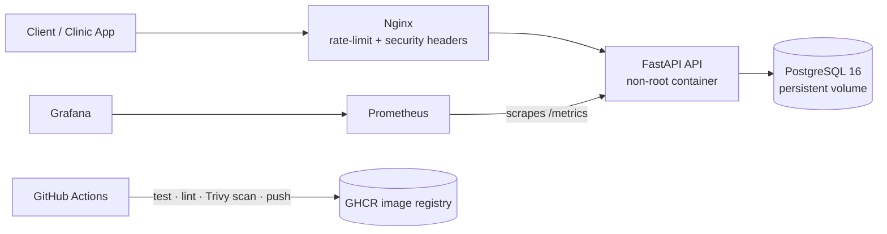

# 🏥 HealthOps — Public Health Vaccination & Stock Platform (DevOps Project)


A production-style, fully containerised platform for a **government health department** to manage
vaccination appointments and monitor clinic vaccine stock — built to demonstrate an end-to-end
**DevOps workflow**: containerisation, CI/CD, security scanning, reverse proxy and observability.

## The real-world problem

District clinics often run out of vaccines unnoticed, while patients are booked for doses that don't exist.
Health officials have no live view of stock across facilities. HealthOps solves this:

- Booking an appointment **atomically decrements stock** and rejects bookings when stock is exhausted.
- `/stock/low` shows which facilities need urgent resupply.
- Live **Grafana dashboards** track total doses per vaccine and API health.
- **No PII is stored** — patients are referenced by pseudonymous IDs (privacy-by-design).

## Architecture



## DevOps features

| Area | Implementation |
|---|---|
| Containerisation | Multi-stage Dockerfile, slim base, **non-root user**, `HEALTHCHECK` |
| Orchestration | Docker Compose with health-gated startup (`depends_on: service_healthy`) |
| Network security | API not exposed directly; isolated `backend`/`frontend` networks; `/metrics` blocked at proxy |
| Reverse proxy | Nginx with rate limiting, security headers, hidden version |
| CI/CD | GitHub Actions: Ruff lint → Pytest → Docker build → **Trivy CVE scan** → push to GHCR |
| Observability | Prometheus metrics (request latency, errors, custom stock gauge) + Grafana |
| Secrets | `.env` based config, never committed |
| Testing | Pytest integration tests of the booking flow |

## Quick start

```bash
git clone https://github.com/asadh-74/healthops.git && cd healthops
cp .env.example .env          # edit the passwords
docker compose up -d --build
```

| Service | URL |
|---|---|
| API docs (Swagger) | http://localhost/docs |
| Health check | http://localhost/health |
| Grafana | http://localhost:3000 (user `admin`) |

### Try it

```bash
curl -X POST localhost/facilities -H 'Content-Type: application/json' \
  -d '{"name":"Rural Clinic A","district":"North"}'
curl -X PUT localhost/stock -H 'Content-Type: application/json' \
  -d '{"facility_id":1,"vaccine":"MMR","doses":100}'
curl -X POST localhost/appointments -H 'Content-Type: application/json' \
  -d '{"facility_id":1,"patient_ref":"p-10001","vaccine":"MMR","slot":"2026-11-01T09:00:00"}'
curl "localhost/stock/low?threshold=200"
```

In Grafana → Explore, query `healthops_total_doses` or `rate(http_requests_total[1m])`.

## Run tests locally

```bash
make test
```

## Roadmap / production hardening

- Alembic migrations, JWT/OIDC auth with role-based access (nurse / district officer)
- TLS via Let's Encrypt (Traefik/Caddy), Terraform for AWS (ECS/EC2 + RDS)
- Alertmanager rules for low stock and 5xx rate, centralised logging (Loki)
- Kubernetes manifests / Helm chart

## Tech stack
Python 3.12 · FastAPI · SQLAlchemy · PostgreSQL · Docker · Docker Compose · Nginx · Prometheus · Grafana · GitHub Actions · Trivy

## Public portfolio demo

The root URL provides a responsive clinic dashboard: create a fictional facility, set stock, book an appointment, and inspect low-stock items and recent bookings. Reservations use a conditional SQL update so concurrent requests cannot decrement the last dose twice.

Render single-service settings: Python 3.12, build `pip install -r requirements.txt`, start `uvicorn app.main:app --host 0.0.0.0 --port $PORT --workers 1`. Set `DATABASE_URL=sqlite:////tmp/healthops-demo.db` for an explicitly temporary free demo. Records reset on service replacement. For durable use, configure a separately managed PostgreSQL database and add authentication before accepting real information.

This is a public fictional-data demo, not a government deployment or a clinical system. Authentication remains a future requirement. The Docker Compose stack provides the separate Prometheus/Grafana services locally; those are not included in the single-service hosted demo.


## Complete recording workflow
1. Click **Load fictional demo clinics** to seed sample facilities idempotently.
2. Book an appointment against available vaccine stock. Show stock and booked totals changing.
3. Restock that clinic and show the new quantity and activity trail.
4. Cancel the appointment to return exactly one dose; repeated cancellation is rejected. A completed appointment keeps its consumed dose.
5. Download the stock CSV report.

Booking and cancellation use database transactions. Automated tests cover competing bookings for the last dose and one-time cancellation refunds. This public portfolio demonstration has no authentication: enter fictional records only. SQLite storage on the free deployment is temporary, not a production medical record system.
